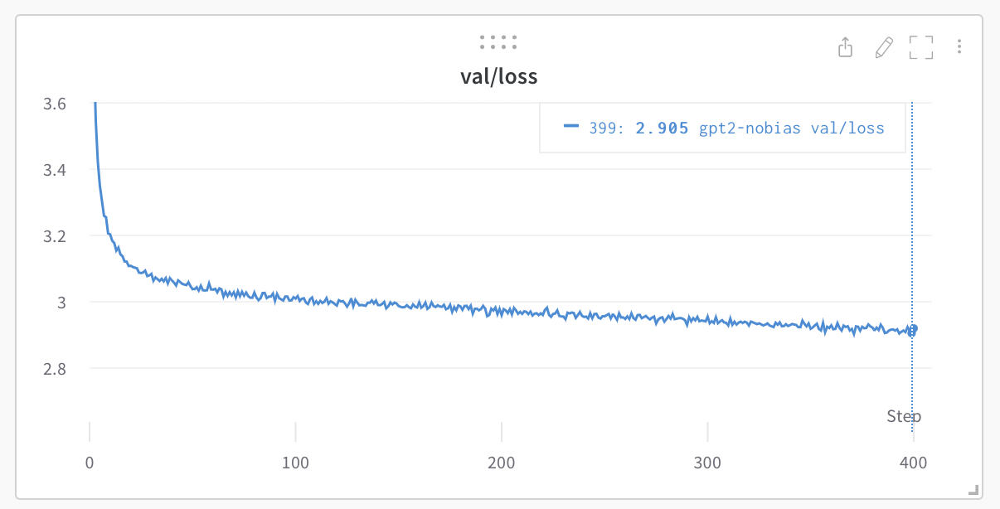

# GPT

A powerful, efficient implementation for training and using GPT models, now with unlimited context capability. This repository extends the [minGPT](https://github.com/karpathy/minGPT) foundation with advanced features while maintaining its clean, readable codebase.



## Key Features

- **Clean, Readable Codebase**: Simple yet powerful implementation in ~600 lines of core code
- **Unlimited Context Support**: Process arbitrarily long contexts with intelligent token retention
- **Multi-Version Architecture**: Support for GPT-2, GPT-3, GPT-3.5, GPT-4, GPT-4.5 and theoretical GPT-5
- **Mixture of Experts Support**: Efficient scaling through MoE architecture
- **Dynamic Memory Management**: Uses minimal resources with automatic scaling
- **Full Training Pipeline**: Train from scratch or finetune existing models

## Installation

```bash
pip install torch numpy transformers datasets tiktoken wandb tqdm psutil
```

## Quick Start

### Training a Model

For GPT-2 reproduction on OpenWebText:

```bash
# Process dataset
python data/openwebtext/prepare.py

# Train GPT-2 with distributed data parallel
torchrun --standalone --nproc_per_node=8 train.py config/train_gpt2.py
```

For Shakespeare character-level model (quick demo):

```bash
# Process dataset
python data/shakespeare_char/prepare.py

# Train a small model
python train.py config/train_shakespeare_char.py
```

### Using Unlimited Context

Our implementation supports theoretically unlimited context lengths through intelligent token management:

```python
# Import the necessary components
from version_manager import create_model, enable_unlimited_context

# Create any GPT version
model = create_model('gpt4')

# Enable unlimited context with custom preservation ratios
model = enable_unlimited_context(
    model,
    preserve_begin_ratio=0.1,  # Keep 10% of tokens from beginning
    preserve_end_ratio=0.2,    # Keep 20% of tokens from end
)

# Now use the model with unlimited context
# Middle tokens will be automatically evicted when memory is constrained
```

Run the demo to see it in action:

```bash
python simple_demo.py
```

### Switching Between GPT Versions

```python
from version_manager import create_model

# Available versions: 'gpt2', 'gpt3', 'gpt3.5', 'gpt4', 'gpt4.5', 'gpt5'
model = create_model('gpt3.5', block_size=32768)  # Override config if needed
```

## Model Architecture

The repository supports multiple GPT versions with different parameter counts and capabilities:

| Version | Parameters | Context Length | Architecture                     | Special Features                          |
|---------|------------|----------------|----------------------------------|-------------------------------------------|
| GPT-2   | 124M-1.5B  | 1,024          | Standard Transformer             | Basic attention                            |
| GPT-3   | 175B       | 2,048          | Scaled Transformer               | Improved attention patterns                |
| GPT-3.5 | ~350B      | 16,384         | Optimized Transformer            | Instruction tuning                         |
| GPT-4   | ~1.7T      | 128,000        | Mixture of Experts               | Advanced reasoning                         |
| GPT-4.5 | ~3T        | 512,000        | Enhanced MoE                     | Specialized reasoning experts              |
| GPT-5   | 1,000B     | 1,000,000,000+ | Advanced MoE + Dynamic Context   | Unlimited context with memory optimization |

## Dynamic Context Management

Our implementation includes a sophisticated context management system that allows processing arbitrarily long contexts while efficiently managing memory:

- **Token Preservation**: Always keeps beginning and end tokens for context coherence
- **Importance-Based Eviction**: Middle tokens are evicted based on importance when memory is constrained
- **Memory Efficiency**: Uses resources proportional to active context, not total context length
- **Configurable Behavior**: Adjust which tokens to preserve and how to score importance

For more details, see [UNLIMITED_CONTEXT.md](UNLIMITED_CONTEXT.md).

## Advanced Usage

### Model Versions and Branch Structure

The repository is organized into branches for different GPT versions:

```
main
├── base            # Core shared functionality
├── gpt2            # GPT-2 (124M params)
├── gpt3            # GPT-3 (175B params)
├── gpt3.5          # GPT-3.5 (~350B params)
├── gpt4            # GPT-4 (~1.7T params)
├── gpt4.5          # GPT-4.5 (~3T params)
└── gpt5            # Theoretical GPT-5 (1000B params)
```

To set up the branch structure:

```bash
./setup_branches.sh
```

### Extended Model Capabilities

For mathematical and reasoning capabilities similar to frontier models:

```python
from version_manager import create_model

# Create GPT-5 with reasoning capabilities
model = create_model('gpt5', enable_reasoning=True)

# Enable hybrid thinking modes (explicit reasoning vs. fast responses)
model.config.hybrid_thinking = True
```

## Repository Structure

```
/
├── assets/                 # Images and other assets
├── config/                 # Training configurations
├── configs/                # Model-specific configs
├── data/                   # Dataset preparation scripts
├── models/                 # Model implementations
├── dynamic_context.py      # Unlimited context implementation
├── model.py                # Core GPT model definition
├── sparse_attention.py     # Sparse attention mechanisms
├── train.py                # Training script
├── sample.py               # Generation script
├── version_manager.py      # Version management utilities
└── UNLIMITED_CONTEXT.md    # Detailed documentation on context handling
```

## Performance and Scaling

- **GPT-2 (124M)**: Trains in ~4 days on 8x A100 40GB GPUs
- **Unlimited Context**: Minimal memory overhead when processing small contexts
- **MoE Efficiency**: Significantly reduced computation through selective expert activation

## Further Reading

- For implementation details, see [ARCHITECTURE.md](ARCHITECTURE.md)
- For unlimited context documentation, see [UNLIMITED_CONTEXT.md](UNLIMITED_CONTEXT.md)
- For scaling laws analysis, see the [scaling_laws.ipynb](scaling_laws.ipynb) notebook

## Citation

If you use this codebase in your research, please cite:

```bibtex
@misc{karpathy2023minimalGPT,
  author = {Andrej Karpathy},
  title = {minimalGPT},
  year = {2023},
  publisher = {GitHub},
  journal = {GitHub repository},
  howpublished = {\url{https://github.com/karpathy/minGPT}}
}
```

## License

MIT
